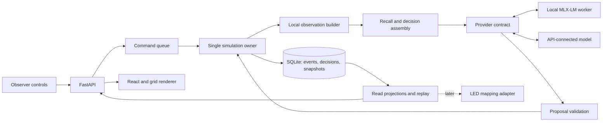

# Proposed Genesis architecture

Status: updated 2026-11-10. **M01–M10 are implemented (see [M07A](validation/M07A.md), [M07B](validation/M07B.md), [M08](validation/M08.md), [M09](validation/M09.md) and [M10](validation/M10.md) validation); later milestones remain proposals.** M10 tendencies are drawn in `engine/world.create_world`, stated by prompt `decision-v4`, and summarized by `SqliteStore.behaviour_stats`. M09 inbox delivery, expiry and reading live in `engine/messages.py`; transfer and communicate validation in `engine/actions.py`. M08 places memory writes, eviction and upkeep in `engine/memory.py` (they mutate state) and recall in `cognition/retrieval.py`. MLX-based local inference and API-connected model support are user-directed requirements. Constitutional requirements are confirmed; future defaults below remain reversible experiment parameters. See [M01 validation](validation/M01.md), [DECISIONS.md](DECISIONS.md) for status and [ROADMAP.md](ROADMAP.md) for delivery order.

## Design and constitutional alignment

Use a Python simulation core with one state owner, a FastAPI observer/control API, SQLite history and a React browser interface. Model providers support both **local MLX-LM on Apple Silicon macOS** and **API-connected models**, including remote hosted or self-hosted endpoints. The default first experiment shares one local MLX-LM model across isolated organism contexts; a run can explicitly select an API provider instead. Ollama is excluded from the planned stack. Start with Canvas 2D; preserve a rendering interface for PixiJS or LEDs. Keep the implementation a small modular application, not a distributed service system.

| Constitutional commitment | Architectural consequence |
|---|---|
| Finite lives; no guaranteed progress (§1, §4) | Private lifespan deadline, metabolic cost, terminal death, archived extinction; no population maintenance loop. |
| Limited resources; action boundary (§1, §5) | Integer resource ledger, strict proposals, semantic validation and atomic commits owned by the engine. |
| Partial knowledge (§1, §6) | Observation builder is the only world-to-cognition boundary; isolated memories and local messages. |
| Consequences; observable causality (§1, §7) | Persistent cell modifications, append-only events, immutable decisions and reconstructable history. |
| Variable inheritance (§4) | Fresh child identity with bounded, imperfect copied information; no resumed parent instance. |
| Stable foundation (§5, §8) | Model outputs cannot change physics, execute code or access host tools. Technical recovery never rescues populations. |
| Display independence (§9) | Read-only state projections; no movement, aging or collisions in the browser. |

The provider returns data, never engine commands with implicit authority. Technical scheduling may invoke cognition; the engine alone approves effects. The observer can inspect privileged information without that information entering organism prompts.

## Boundaries and proposed file organization

This table describes the target organization. The M01 subset now exists; add the remaining files only when their milestone needs them. M01 uses `persistence/runs.py` for minimal saved frames; the full event/snapshot store below is future work.

| Package/path | Owns | Must not own |
|---|---|---|
| `backend/genesis/domain/` (`state.py`, `actions.py`, `events.py`, `config.py`) | Typed cells, organisms, proposals, event contracts, versioned configuration | Network, storage, UI |
| `backend/genesis/engine/` (`world.py`, `rules.py`, `ledger.py`, `perception.py`, `lifecycle.py`, `inheritance.py`) | Pure transition logic, local visibility, costs, birth/death | Model calls or human narrative |
| `backend/genesis/runtime/` (`scheduler.py`, `runner.py`, `commands.py`) | Tick barrier, deterministic ordering, pause/resume, command serialization | Independent physics rules |
| `backend/genesis/cognition/` (`policy.py`, `context.py`, `memory.py`, `retrieval.py`, `reflection.py`, `prompts/`) | Bounded recall and proposed decisions from allowed information | Full world object, database connection, other private memories |
| `backend/genesis/providers/` (`base.py`, `recorded.py`, `mlx.py`, `mlx_worker.py`, `http_chat.py`, `config.py`) | Local MLX-LM worker and API transport, connection profiles, capability declarations, metadata, technical errors | Action validation or resource creation |
| `backend/genesis/persistence/` (`sqlite.py`, `schema.sql`, `events.py`, `snapshots.py`, `replay.py`, `backup.py`) | Transactions, append-only records, versioned reconstruction, migrations | Asking a model to reconstruct history |
| `backend/genesis/api/` (`app.py`, `routes.py`, `schemas.py`) | Read views and authenticated-by-local-access development controls | Arbitrary organism edits or duplicate schedulers |
| `backend/genesis/ops/` (`health.py`, `metrics.py`, `recovery.py`) | Failure detection, technical pauses, invariants, archive verification | Replenishing resources or restarting extinct populations |
| `web/src/` (`App.tsx`, `api.ts`, `components/`, `renderers/`) | Controls, grid drawing, selection, history and inspector panels | Canonical state transitions |
| `tests/` (`unit/`, `properties/`, `integration/`, `fixtures/`, `e2e/`, `soak/`) | Offline fixtures and observable acceptance evidence | Treating scripted behavior as emergence |

Prefer plain typed Python objects and functions for the domain, Pydantic at untrusted/API boundaries, the standard `sqlite3` library for storage and an asynchronous HTTP client for inference. No agent framework, vector database, ORM, task broker or ECS is initially required. Those would add coordination and persistence surfaces without solving the first experiment.

## World and resources

Proposed initial world: 32 × 32, `(x, y)` coordinates with origin at top left, bounded edges, cardinal movement, at most one living organism per cell. Dimensions and topology are run configuration, frozen for that run. Resource and environmental rules are likewise versioned and immutable during a run; changing one starts a new experiment.

Minimal cell data:

- `energy`: integer 0–100, extractable energy.
- `loose_material`: nonnegative integer material units.
- `packed_material`: integer 0–8, placed/removed by organisms; movement cost derives from this quantity.
- Stable coordinates and a revision. Occupancy is derived from organism locations and checked for uniqueness.

Do not add roads, cities, ownership, professions, temperature, chemistry or signal propagation. Packed material is one composable physical primitive. Entering a cell costs `1 + floor(packed_material / 2)` energy. Packing changes effective geography without assigning a purpose to it. Removal returns packed units to an organism's material inventory with capacity checks. No automatic decay initially; later decay would require a logged environmental rule.

Proposal for first environment: seeded initial energy/material distribution; every tenth tick each cell gains up to one energy unit, capped at 100. Log the actual addition as an environmental source. This is an explicitly open energy system, not an unaccounted creation. Material has no regeneration. Do not adjust either rule to current population. Test depleted and zero-inflow configurations as legitimate alternatives.

Ledger invariants, using actual amounts rather than requested amounts:

`cell energy + living organism energy = initial energy + environmental inflow - action/cognition/upkeep dissipation - death retirement`

`loose material + packed material + living carried material + retired material = initial material`

On death, remaining carried resources enter explicit retired accounting. They do not appear in the cell or form a corpse/structure. This default follows the constitution's constraint against death itself transforming geography. Any recycling rule is a separate design question. History storage is technical archival capacity, separate from an organism's costly, limited active memory.

## Organism state and information access

An organism has an opaque ID, birth tick, parent IDs, generation, location, energy/material inventories and capacities, tendency vector, active memory references, a bounded inbox, decision due tick and living/dead status. Engine-private state includes sampled lifespan deadline, random-stream state and accounting details.

Suggested laboratory defaults: 10 initial organisms; energy capacity 100/start 60; material capacity 20; basal upkeep 1 energy/tick; lifespan sampled uniformly from 160–240 ticks. Numbers are starting hypotheses requiring review, not tuned claims of viability. Each tick checks death before new decisions. Zero energy after an action also causes death in that tick. A dead ID can never act again.

The model receives its age, energy/material, tendencies, known action rules, current local cells, visible organism IDs/positions and delivered messages. Start with Manhattan radius 2 (at most 13 cells), no occlusion and at most eight local event summaries. Neighbors' exact energy, memories, tendencies and lifespan deadlines are private. Its own exact lifespan, world seed/PRNG state, global ledger, global organism count and observer history are excluded. Give general finite-life information without the sampled death tick. After death, the observer may inspect the deadline in history. Inbox capacity is eight messages including reserved pending deliveries; messages expire after 20 ticks with logged removal from active state. A recipient dying before delivery receives no new active memory; the accepted send and failed delivery remain in history, with no fee refund.

Past observations record their tick. A remembered distant cell remains historical evidence, never a refreshed view. Natural-language claims from others are tagged as received claims. All messages and memories are untrusted text, not instructions granting tools or access. The model never receives filesystem, shell or database tools.

Initial tendencies are independent bounded weights for maintenance, caution, curiosity, affiliation, experimentation and transmission. They modulate the prompt, alongside current needs; they neither reserve actions nor assign a role. No deterministic “curious agent must explore” rules. Default weights remain stable within a life; changing strategies through memory is sufficient for MVP. Bounded tendency revision is a later explicit experiment, and any such changes must be logged.

## Primitive action contract

One proposal per due decision. Transport fields include request ID, actor ID, observation hash, target tick and schema version, bound by the runtime rather than trusted from generated text. The generated payload selects one allowed action, typed arguments and optionally a short explanation. Explanations are model reports, not proof of hidden reasoning.

| Primitive | Initial semantics | Validation and resource effects |
|---|---|---|
| `wait` | Do nothing intentionally for this action opportunity | No action-specific fee; normal upkeep and decision costs still apply. |
| `move(direction)` | One cardinal cell | Inside bounds, vacant destination, enough energy for derived entry cost. No teleport/path execution. |
| `extract(resource, amount)` | Take energy or loose material from current cell | Positive integer, maximum 10 units/action, sufficient source/capacity and 1 energy fee paid from existing energy. Reject over-requests rather than silently clamp. |
| `transfer(target, resource, amount)` | Send carried energy/material to a living adjacent organism | Available balance including fee 1, recipient capacity, valid range. Transfer is atomic. No recipient response implied. |
| `communicate(target, text)` | Deliver a bounded local message | Living adjacent recipient, inbox capacity, at most 256 UTF-8 bytes; fee `1 + ceil(bytes/64)`. Becomes visible at the next tick, not mid-round. |
| `modify(mode, amount)` | Pack carried material into current cell, or unpack it into inventory | Positive amount ≤2, available source and destination space; fee 2 per unit. Material is transferred, never invented. |
| `reproduce(direction, endowment, memory_ids)` | Attempt asexual birth into a vacant adjacent cell | Parent alive; cooldown 20 ticks; parent must retain ≥10 energy after fee 10 plus endowment ≥20. Optional material/memory transfer has capacity/cost checks. All checks precede mutation. |

Amounts, fees and cooldowns belong to the proposed ruleset. Reproduction gets enabled only after its milestone; earlier decision schemas exclude it. A local source of material must be seeded so modification is actually possible. `wait` avoids forcing unnecessary movement or communication. Observation is automatic local sensing covered by upkeep in MVP; defer a separate `observe` primitive until it offers a distinct, justified capability.

Validate schema strictly (including unknown fields and numeric bounds), then actor liveness, observation/tick binding, action availability, range, permissions, balances, capacity and conflicts. Compute a candidate delta, check invariants and commit once. Invalid proposals create diagnostics only: no inventory, position, memory or cell effects attributable to that proposal. Basal upkeep and scheduled cognition charges occur separately according to the published tick rules, whether an action is valid or invalid. They are never disguised rejection penalties. No automatic replacement action or unlimited corrective re-prompt.

## Simulation clock and scheduling

Separate logical ticks, wall time, inference time and render frames. Speed controls set maximum tick pacing; they cannot change costs, lifespan, decision frequency or event ordering. Closing a browser does not stop the engine. A slow model slows wall-clock progress without silently aging its organisms.

Proposed tick protocol:

1. Begin from the last committed state. Apply environmental inflow, aging, upkeep and resulting deaths to a private candidate state.
2. Identify due surviving organisms. A decision is normally due every four ticks; a new local message or a significant observed resource change can make the next tick due. Coalesce triggers; minimum gap one tick, maximum one decision per organism per tick. New births become eligible next tick. Trigger detection uses only the same local sensing available to the organism, never unseen distant changes.
3. Charge a fixed 1 energy for a due cognition opportunity if affordable; recheck death. Assemble all observations from the same candidate state before any proposed action is applied. Persist request inputs and stable IDs in the technical request inbox.
4. Obtain responses through a bounded queue, initially one inference at a time. Keep partial responses durably. Do not hold a database write transaction during inference. Staged physical effects remain invisible until the tick commits.
5. Resolve proposals against the evolving candidate state in stable ID order rotated by tick index. Earlier valid actions may invalidate later targets or capacity. Reject conflicts without partial effects. After each valid action, immediately apply any zero-energy death before resolving the next actor; a later transfer cannot revive that ID. Record the order so scheduling bias is inspectable. Do not reorder by model completion speed.
6. Apply paid memory/reflection operations for surviving organisms where enabled, checking death immediately after each charge; schedule next-tick message deliveries and detect extinction. Atomically append all state events and update committed state, processed request IDs and tick number. Publish only after commit. Deliveries due now are made before observation assembly, after the opening mortality checks; active inbox expiration is likewise an explicit environmental processing rule.

A tick without due cognition makes no model request. Temporary inference failure causes a visible technical wait/pause at the barrier; no committed ecological time passes until the tick can finish. One bounded transport retry is proposed; repeated errors pause the run. A well-formed but illegal decision, or a model output that cannot be parsed, is recorded as rejected and consumes the scheduled opportunity; it does not trigger ecological rescue. Persistent parse failures can trigger a technical pause for operator review.

Pause requested during inference prevents the pending tick from committing until resume; completed replies may be retained. UI shows committed tick and pending work separately. Explicit step permits one complete tick. Recovery resumes from a verified boundary with stored requests/responses; it never repeats committed costs or births. Changing wall-clock pacing or pausing is logged as operator control metadata.

One process owns the live world and DB write queue. FastAPI handlers enqueue commands. Do not start a runner in each Uvicorn worker: [multiple workers are separate processes](https://fastapi.tiangolo.com/deployment/server-workers/). A later split can move this same owner behind IPC without changing domain contracts.

## Cognition and memory

The initial loop is local observation → bounded recall → one structured decision → engine outcome → deterministic memory update. A fixture policy proves the contract before live inference. Recorded responses are keyed by request/input hash; a mismatch is an error, never silently matched by call order.

Active memory starts with at most 64 records and 16 KiB of text per organism, with a 256-byte per-record text limit. Store type (`observation`, `outcome`, `message`, `reflection`, `inherited`), acquisition tick, source event/reference IDs and provenance. Creation costs 1 energy per started KiB of newly stored text; maintenance costs 1 energy per started KiB of active text every ten ticks, charged with opening upkeep before decisions. Deterministic capacity eviction removes least-recently-acquired active records first, stable ID tie-break; the historical record retains them. If creation is unaffordable, skip it with a logged reason. Replay includes active membership and costs. Automatic outcome memories describe accepted actions; rejection diagnostics stay outside the active memory mutation path and may be included as the previous decision result at the next scheduled opportunity.

Start retrieval with elapsed-tick recency, keyword overlap and fixed event-category salience. Normalize with empty/equal-score guards and stable ties. Return at most eight records under a total prompt budget. Score and selected IDs are inspectable. Semantic retrieval is optional after a measured failure case; embeddings stay per-content cached and versioned by model, without granting shared personal memory.

Reflection is a separate bounded opportunity after at least eight new salient records and a cooldown of 20 ticks, with at most one request and two resulting memories. An eligible, affordable reflection replaces that organism's next action-decision request: select its purpose before observation assembly and obtain its response in the same request barrier. There is never both an action request and reflection request for the same organism in one tick. An accepted reflection costs 2 energy plus storage, in addition to the separately scheduled cognition charge, and its evidence must refer to currently accessible memory. Validate all output and costs before storing anything; reject unsupported references. Historical source links remain observer-only if the organism has forgotten the source. Reflection does not retrain weights or overwrite observed facts.

## Reproduction and inheritance

Birth is one atomic event group: fee and endowment debits, new ID, location, independent cognition state, lifespan sample, ancestry and inherited values. A parent proposal triggers it; population size never does. The initial implementation passes a bounded random subset of tendencies with small seeded perturbations and gives remaining tendencies fresh values. Each value is clipped to its configured range; log the mask, pre/post values and random draw results.

Next add optional parent-selected active memories: at most two; parent pays storage/transmission cost; each has independent 50% retention probability; truncate to the child's per-record limit and label as inherited with ancestor/source/acquisition metadata. No fabricated replacement memory when one is dropped. Offspring may receive zero memories. Child state and subsequent edits never alias parent objects. Do not copy current plans, exact deadline, private PRNG state, full context or parent ID as identity. Memory selection/truncation/retention parameters are reversible defaults. Initial seed organisms have no parents; spontaneous mid-run births are out of scope.

Last living death produces exactly one extinction record, stops ecological advancement and archives the run. Inspect/replay remain available. A new seed population always starts a new run ID.

## Persistence, replay and recovery

Use one local SQLite database per run initially. Tables: `run_manifest`, append-only `events`, append-only `decision_attempts`, append-only `request_records` (requested/completed/abandoned records), `snapshots`, and rebuildable current-state/read indexes. Enforce unique `(run_id, sequence)` and request consumption keys. Mutable projections are explicitly disposable; history is not.

Each event includes sequence, logical tick and phase, type, actor or environmental rule/operator identity, affected IDs/coordinates, causal request/event IDs, schema/rules version, before/after values or an exact reconstructable delta. Include births, deaths, mutations, memory membership/content changes, messages, rejected actions and operator interventions. Distinguish state events from diagnostics and wall-clock metrics.

The manifest captures seed, seeded RNG algorithm/version, initial state, rules/config hash, engine revision, event schema, prompt versions, provider kind/runtime version, sanitized endpoint identity, model identifier and available revision/digest, quantization/context/sampling settings and model license reference. For hosted models, record the requested name and returned version/fingerprint when supplied; mark unavailable weights/digests as unknown rather than claiming they are pinned. Persist exact bounded prompts and raw outputs, parse/validation results and usage metadata. Store no API secrets or authorization headers. A prompt is evidence of supplied information; an explanation is not a complete causal account of model computation.

The event reducer applies recorded effects without new inference or rerunning changed rules. Snapshots initially every 100 ticks and on graceful pause/close include state, active memories, inboxes, scheduler state, RNG state, last sequence and checksum. Recovery also reads durable pending requests. Canonical state hashing excludes wall-clock metrics and includes all future-decision-relevant state. Ordered integer resource updates avoid floating-point ledger drift.

Transaction: events + tick/state projection + request consumption marker commit together. On failure roll back; publish nothing. At restart validate manifest/schema, SQLite integrity and snapshot checksum, replay tail events and remain paused for inspection if verification fails. Try an earlier valid snapshot when available; missing/corrupt history stops recovery and is never filled by generation. Unrecorded replies lost in a crash require a logged retry, and may differ; replay only guarantees already committed history.

Use local storage and conservative durability settings. [SQLite WAL](https://www.sqlite.org/wal.html) still has one writer; verify the fixed runtime described in [RESEARCH.md](RESEARCH.md), checkpoint deliberately and keep readers short-lived. Use the [backup API](https://www.sqlite.org/backup.html), not an uncoordinated copy of a live DB file. Test disk-full and interrupted commits. Compression/archival must verify checksums and preserve reconstructability; never prune meaningful events because storage is inconvenient. Low disk space pauses technical operation.

## Local MLX-LM and API-connected models

The provider contract is `decide(request) → response or typed technical failure`, with declared structured-output capabilities, context/output limits, cancellation/timeout behavior and available usage metadata. Reflection uses the same adapter with a different purpose/schema. The domain consumes a normalized proposal, independent of transport or model vendor. Three implementations belong in the initial plan: recorded responses (M06), local MLX-LM (M07A), and a configurable HTTP model connection (M07B). Selecting a provider for a new run is available before the later comparative-experiment UI in M17.

**Local runtime.** MLX is Apple's machine-learning framework designed for Apple Silicon; MLX-LM supplies LLM loading and generation. Use its Python API in a dedicated subprocess with one resident model and a bounded request channel. The engine process need not import MLX when an API-only run is selected. This keeps the API/observer responsive and contains native inference failures. Model path/revision, tokenizer/chat template, quantization and runtime versions are recorded. Verify macOS/runtime compatibility when implementing, and select a model without downloading anything during planning. See the [MLX documentation](https://ml-explore.github.io/mlx/build/html/index.html) and [MLX-LM repository](https://github.com/ml-explore/mlx-lm).

**API connections.** Provide a server-side connection profile with provider kind, base URL, model ID, optional API-key environment-variable reference, timeout, context/output limits and capabilities. Start with an OpenAI-compatible chat-completions adapter for endpoints that actually support that protocol; this describes the wire format and does not require choosing OpenAI as the vendor. Other protocols can implement the same provider interface through dedicated adapters. Compatibility must be tested per endpoint; an arbitrary model API is not automatically compatible. Use HTTPS for remote endpoints, permit loopback HTTP for local/self-hosted development, and send requests from the backend. Credentials never enter browser responses, prompts, manifests or logs. Model lists are optional; manual model-ID entry must work.

**Structured actions.** Use native JSON-schema constraints only when verified for that provider/runtime. Otherwise supply the schema in the prompt, parse the returned JSON and apply strict Pydantic plus engine validation. Do not equate JSON prompting with constrained decoding. The inspected [MLX-LM server source](https://github.com/ml-explore/mlx-lm/blob/56230fa02b8ff8330daf26dc95c28480423ed5fe/mlx_lm/server.py) has chat-completion routes but no `response_format`/`json_schema` handling; therefore the plan does not promise Ollama-style schema enforcement in MLX-LM. A later constrained-decoding addition needs its own compatibility tests. Malformed output is recorded and rejected, never converted into an invented valid action. Structured-output reliability is an M07A acceptance risk.

**Remote operation.** Show selected provider/model and whether bounded organism observations will leave the Mac. Explicit API selection sends only the same allowed organism context used locally, never the global state or history database. Track requests, tokens and latency; show cost estimates only with a recorded pricing source/version, and mark missing usage as unknown. Configurable request/token budgets and optional cost estimates belong to technical operations, separate from ecological energy. Budget exhaustion, network errors and rate limiting wait/pause at the same tick barrier. Bound retries for transient failures; authentication/configuration errors require correction. Ambiguous network retries may incur additional billing but must never cause duplicate world effects.

The provider profile is fixed for a run. An unavailable local model must not silently switch to a paid remote API, or vice versa. Choose another provider in an explicitly new run; mixed-model populations and hot-swapping remain later experiments. Record actual replies so replay needs neither the MLX runtime nor API connectivity/credentials. Remote model updates can change fresh outputs even when a model alias is unchanged; this does not weaken exact replay of already recorded history.

## Apple Silicon performance

For the 128 GB Mac, begin with one resident quantized instruction model in roughly the 7–14B class, selected later for action-schema accuracy, latency, license and context needs. This is a sizing hypothesis, not a model recommendation established by benchmarks. Weight-only storage is approximately `parameters × quantization_bits / 8`; 8B at four bits is about 4 GB before scales, runtime buffers and KV cache. Unified memory is shared with macOS and other applications, and available memory alone does not predict generation speed. Keep substantial headroom and monitor pressure/swap.

Ten organisms share weights but use separate bounded requests. Start concurrency at one, explicitly limit context to roughly 4K tokens, cap output around 256 tokens and bound total prompt assembly including schema. Trim memory first, never action constraints. Reserve capacity for the selected model's tokenizer/template; refine budgets when it is chosen. Keep no persistent chat session per organism and avoid ten independent model loads. A shared static prompt prefix is an optimization only; user-specific suffixes remain isolated.

Approximate wall time per decision round is `due requests × (prompt evaluation + output generation + overhead)` at concurrency one. If ten requests each take an assumed two seconds, a round takes about twenty seconds; this is arithmetic, not a hardware measurement. Speed controls cannot overcome that barrier. Use event coalescing, periodic decisions and bounded reflection, then measure actual request counts and latency before adding parallelism. Bound worker queues and KV/prompt caches explicitly; never reuse one organism's private conversation as another's prefix. For remote providers, network latency and rate limits add overhead; local weight/KV memory estimates do not apply.

MLX-LM is the selected local path, not a claim of measured superiority over other runtimes. Verify model format, tokenizer, template, output validation, sampling and metadata across both adapters. No models or dependencies are installed by this plan.

## Web experience and extension points

Initial layout: top run/tick/status bar and controls; central square grid with coordinate/energy legend; right cell/organism inspector; bottom chronological event list. Canvas renders plain squares and organism markers. React owns controls and panels. Keyboard coordinate selection and textual values complement color. “New run” is separate from resume and requires an explicit seed/config selection; it never replaces an extinct run silently.

M01 shows a backend-provided grid and cell selection. M02 adds step/start/pause/resume/speed, energy changes and environmental events. M07A/M07B add a new-run provider selector: local MLX-LM model or configured API connection/model ID, connection status and context/output limits. API credentials are resolved on the backend. Subsequent inspectors expose perception, action costs, prompt/output and validation, memory, genealogy and historical state as those capabilities arrive. Hidden lifespan is not displayed for living organisms by default. History mode prominently displays its tick and disables live mutation controls.

Begin with REST reads and modest polling (e.g. four updates/second), sequence-aware deltas and a full snapshot fallback. Controls carry idempotency keys. Reconnect from the last sequence; a gap triggers a resync. Later SSE can reduce polling if useful. Pause labels distinguish observer playback from simulation pause. Model text is rendered as text, never raw HTML.

The renderer receives `GridFrame` data (dimensions, values, organism markers and overlays). PixiJS can replace Canvas without changing physics. LED mapping later consumes the same projection: explicit aggregation (sum for resource quantities, occupancy count/max for markers), simulation-to-display resampling, wiring order, brightness/gamma and refresh rate. None feeds back into the engine. Alternative providers use the same decision contract. Public participation requires a separately approved intervention API and attribution rules; no such endpoint is built in MVP.

## MVP boundary

MVP completes at roadmap M16: constrained organisms with local MLX-LM or an explicitly selected API model, costly memory/actions, persistent modification, finite lives, optional agent-initiated reproduction with imperfect inheritance, causal history/basic replay and verified crash recovery. The first reference experiment remains local, consistent with the constitution. A run with extinction is a complete experiment. API connectivity is an MVP capability; comparative experiment tooling, better displays, embedding retrieval, changing tendencies, public input, LED hardware and evolved local protocols remain later hypotheses.
